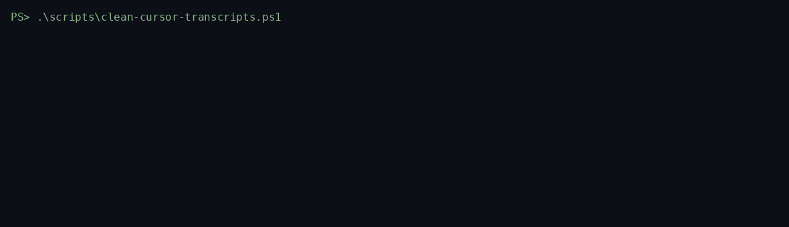

# cursor-transcript-cleaner

Reports how much disk Cursor agent transcripts and chat data use per workspace, and moves old transcript logs into a zip you can restore.

## Problem

Deleting the wrong Cursor files empties the Agents sidebar. The sidebar list and the chat records live in `state.vscdb`. The `agent-transcripts` jsonl files are a separate log. This script reports both layers, and it moves only the log shape Cursor staff described, after Cursor is closed, into a zip with a manifest.

## Quick start

You need Windows and Windows PowerShell 5.1 or PowerShell 7. There is nothing to install.

```powershell
git clone https://github.com/kamilkaczmareksolutions/cursor-transcript-cleaner.git
cd cursor-transcript-cleaner
Set-ExecutionPolicy -Scope Process Bypass
powershell -NoProfile -File .\scripts\clean-cursor-transcripts.ps1
```

That command only reads. It is safe while Cursor is open.

Preview an archive of logs whose last write is more than 90 days ago. This still writes nothing.

```powershell
powershell -NoProfile -File .\scripts\clean-cursor-transcripts.ps1 -Archive -OlderThanDays 90
```

Quit Cursor completely, then run the same command with `-Apply`.

```powershell
powershell -NoProfile -File .\scripts\clean-cursor-transcripts.ps1 -Archive -OlderThanDays 90 -Apply
```

`-WhatIf` keeps the run as a preview even if you also pass `-Apply`. The zip defaults to `%USERPROFILE%\cursor-transcript-archives\cursor-transcripts.zip`. Pass `-ArchivePath` to put it somewhere else. The zip must not sit inside `%USERPROFILE%\.cursor` or `%APPDATA%\Cursor`.

Put the files back. The zip stays where it is.

```powershell
powershell -NoProfile -File .\scripts\clean-cursor-transcripts.ps1 -Restore -Apply
```

## Example output

This run used a sample tree, not a live Cursor profile. The same command on your machine prints your paths and sizes.

```text
Project                             Last activity      Transcripts             Chat            Total
(global chat database)                                         0 B          49.0 KB          49.0 KB
C:\src\big                       2026-10-02 18:01           1.2 KB           4.0 KB           5.3 KB
slug:c-orphan-app                2026-01-04 12:00             40 B              0 B             40 B
Total                                                       1.3 KB          53.0 KB          54.3 KB
```



The gif is a terminal replay of that sample run. It is not a recording of a production profile.

## What is safe to archive

The script moves one shape, and only when you pass `-Apply`.

`%USERPROFILE%\.cursor\projects\<slug>\agent-transcripts\<session-id>\<session-id>.jsonl`

The session folder name and the file name must match, and `LastWriteTimeUtc` must be older than `-OlderThanDays`. Each moved file is stored in the zip under the same relative path, with a SHA-256 in `manifest.json`. Restore writes those bytes back and does not change the zip.

Cursor staff described that split in two forum threads. The sidebar list is a session index in workspace storage, not these files ([Agents panel lost session list](https://forum.cursor.com/t/agents-panel-right-sidebar-lost-session-list-no-way-to-restore/153481), [222 transcripts still on disk](https://forum.cursor.com/t/agents-sidebar-empty-222-transcripts-still-on-disk-windows/162757)). A later staff reply on disk growth says the global `state.vscdb` holds chats, agent checkpoints, and related data, and tells people not to delete that file ([125 GB on macOS](https://forum.cursor.com/t/cursor-storage-has-grown-to-125gb-on-my-mac-how-can-i-safely-reduce-it-without-losing-history-context/172127)). The sibling tool [cursor-workspace-migration](https://github.com/kamilkaczmareksolutions/cursor-workspace-migration) copies both the jsonl tree and the databases, and it refuses to write `state.vscdb` while Cursor is running.

The script does not touch any of the following. Staff or the migration repo tie them to the live chat list, or nobody has confirmed they are disposable.

- `%APPDATA%\Cursor\User\globalStorage\state.vscdb` and `state.vscdb-wal`, `state.vscdb-shm`, `state.vscdb.backup`
- `%APPDATA%\Cursor\User\workspaceStorage\<hash>\`, including `state.vscdb`, `workspace.json`, and `images\`
- Any other file under `agent-transcripts`, including a flat `t1.jsonl` or a `.txt`
- The rest of `%USERPROFILE%\.cursor\projects\<slug>\`
- `%USERPROFILE%\.cursor\chats` (the CLI chat store)

The script never opens SQLite. Report mode only adds file lengths.

One limit is still unconfirmed. Staff have not said the IDE redraws a thread after its jsonl is gone. The database they point at for chats stays on disk. If a thread does not open, `-Restore -Apply` puts the same bytes back on the same path.

## FAQ

### Does this break chat history?

The default command does not write. `-Archive` without `-Apply` does not write. `-Apply` refuses to run when a process named `Cursor` is running, and it refuses to store the zip inside Cursor's own data directories.

`-Apply` removes the old jsonl files listed above only after the zip entry matches their SHA-256. It does not edit `state.vscdb`. Running it twice is safe. Files already in the zip and missing on disk are left alone. If a live file is still there and the hash matches, the second run removes the live copy. If the hash differs, the file stays and the process exits 1.

### What does a row in the report mean?

`Transcripts` is every file under that workspace's `agent-transcripts` directory, including files the archive will not move. `Chat` for a project is the whole `workspaceStorage\<hash>` directory whose `workspace.json` points at that folder. `(global chat database)` is the global `state.vscdb` family, counted once, because it is shared by every workspace. A slug with no matching `workspace.json` is labeled `slug:...`. The script does not invent a project path from a slug. Rows are sorted by total bytes, largest first. `Total` is the sum of those rows.

`Last activity` is the newest transcript file time, shown in local time. It is not read from the database.

### Which exit codes matter?

`0` means every planned action was a no-op or a completed move. `1` means at least one file was `Conflict` or `Rejected`, and that file was left in place. `2` means Cursor is running, the zip path is inside a Cursor data directory, or the manifest version is not 1.

## License

MIT. See [LICENSE](LICENSE).
